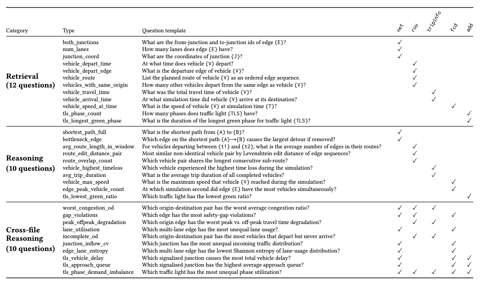
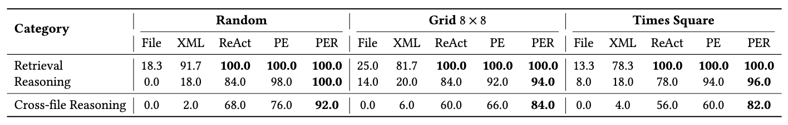

# SUMO-SimQA

A benchmark for measuring how well LLMs can read and reason over raw
[SUMO](https://eclipse.dev/sumo/) traffic-simulation files. Each question is
answered by an LLM that is given the simulation files through one of several
*setups*, ranging from dumping raw XML into the prompt to a
Plan-Execute-Revise (PER) agent that writes and runs Python over the files.

The repository provides the question dataset, the SUMO scenario files, and the
code to collect model answers (`run_experiment.py`) and score them
(`evaluate.py`).

## Requirements

```bash
python3 -m venv .venv && source .venv/bin/activate
pip install -r requirements.txt
```

All setups run on a Claude model (default `claude-sonnet-4-6`). Set your
Anthropic API key in `claude_api.txt` at the repo root, or via the
`ANTHROPIC_API_KEY` environment variable.

## Experiment Setups

`run_experiment.py --condition <name>` selects how the SUMO files are exposed to
the LLM:

| Setup | `--condition` | Description |
|---|---|---|
| File-Description (File) | `file` | File structure description only, no contents. |
| Full-XML (XML) | `xml` | Raw SUMO XML inserted verbatim into the prompt. |
| Code execution (ReAct) | `react` | LLM executes Python code (no plan, no revision). |
| Plan-Execute (PE) | `plan_execute` | LLM plans, then executes as code (no revision). |
| Plan-Execute-Revise (PER) | `plan_execute_revise` | LLM plans, executes, then revises the plan. |

## Dataset

SUMO-SimQA contains **480 questions** = 32 question types × 3 networks × 5 samples. \\
Networks are `grid_8x8`, `random`, and `times_square`. \\
The 32 types fall into three categories of increasing complexity:

- **Retrieval** (12 types) — single field lookup
- **Reasoning** (10 types) — single file, requires computation
- **Cross-file Reasoning** (10 types) — requires two or more files

Each `QAdataset/questions/{network}_{type}.csv` holds 5 samples
(`sample_id` 0–4), with the `question` and its `ground_truth` per row.



## Running experiments

```bash
# One condition / network / type (5 questions)
python run_experiment.py --condition plan_execute_revise \
    --network times_square --type num_lanes

# A single question type across all networks
python run_experiment.py --condition xml --type both_junctions

# The full matrix
python run_experiment.py --all --condition plan_execute_revise
```

Results are written to `QAdataset/results/{condition}_{network}_{type}.csv`.
Existing result files are skipped unless you pass `--force`.

## Evaluating

```bash
# Score everything under QAdataset/results/
python evaluate.py
```

`evaluate.py` writes `*_evaluated.csv` alongside each result file and prints
accuracy per (condition, network, type).

## Results

Accuracy (%) of each setup across the three networks. Prompt-only setups
(File, XML) collapse on cross-file questions, while planning and revision (PER)
recover most of them.



## Repository layout

```
SUMO-SimQA/
├── run_experiment.py        # Collect LLM answers for (condition, network, type)
├── evaluate.py              # Score answers and aggregate accuracy
├── requirements.txt
├── scripts/
│   ├── utils.py             # File-path registry + LLM client helper
│   ├── llm_client.py        # Claude (Anthropic) client
│   └── methods/             # Setup conditions
│       ├── file.py                  # file                 (File)
│       ├── xml_view.py              # xml                  (XML)
│       ├── react.py                 # react                (ReAct)
│       ├── plan_execute.py          # plan_execute         (PE)
│       └── plan_execute_revise.py   # plan_execute_revise  (PER)
├── data/
│   ├── network/             # SUMO networks (.net.xml, _adjacency.json, _tls.add.xml)
│   └── trips/               # Vehicle demand (.rou.xml)
└── QAdataset/
    └── questions/           # {network}_{type}.csv  (question + ground_truth)
```
